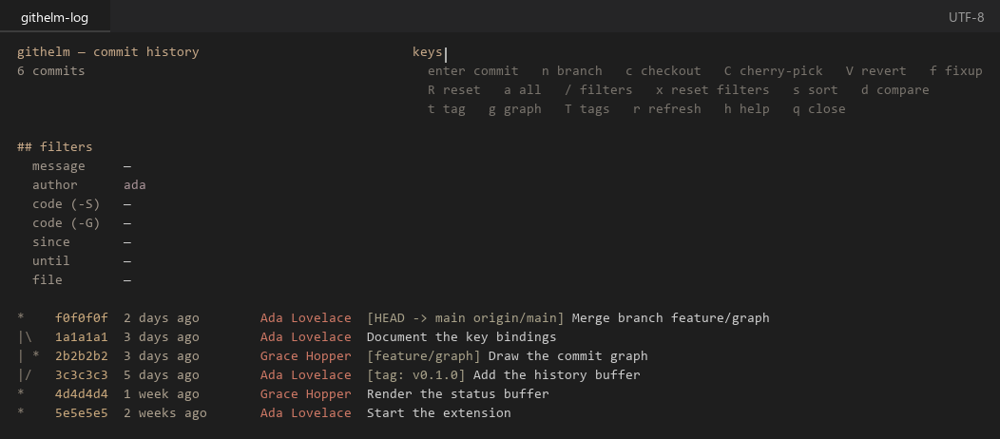

# Git Helm

**English** · [Русский](README.ru.md) · [中文](README.zh.md)

A keyboard-driven, buffer-centric git UI for VS Code.

Every screen is a real text buffer: no trees, no panels, no mouse. You open the status buffer, move the cursor, and act with single keys — `s` to stage, `c` to commit, `i` to add a file to `.gitignore`. Buffers stay in the editor area, so splits, search and the normal editing shortcuts keep working.

## What it does


*`alt+g` opens it: `s` stage, `d` diff, `c` commit, `Ctrl+S` records the commit.*

| Screen | Highlights |
| --- | --- |
| **Status** (`alt+g`) | staged / unstaged / untracked / conflicts, stage a file, a whole section or the selection, commit, amend, stash, remotes, worktrees, fetch/pull/push, reset, abort merge, diff, open file |
| **Diff** | stage or unstage the hunk under the cursor or the selected lines, `Enter` opens the file at that line |
| **History** | ASCII graph, commit details, branch/checkout/cherry-pick/revert, fixup + autosquash, filters by message/author/date and `git log -S` / `-G`, sort cycles, compare two commits, reset to a commit |
| **Branches** | local and remote (toggle), upstream and divergence, checkout / create / rename / delete / set-upstream / merge / reset |
| **Tags** | list, show the commit, create, move to `HEAD`, delete |
| **Commit** | metadata, stat and the full patch of the commit you are writing |
| **File** | `git log --follow` and `git blame` for the current file |
| **Conflict** | take ours / theirs / base per file, mark resolved, or jump into the built-in merge editor |
| **Action log** | every `git` invocation the extension made, with timing and exit code |

## Install

Requires VS Code 1.85 or newer and a `git` binary on `PATH`.

From the Marketplace: search for **Git Helm**, or

```bash
code --install-extension <publisher>.githelm
```

From a VSIX:

```bash
code --install-extension githelm-X.Y.Z.vsix
```

From source:

```bash
npm install
npm run build
```

Then either press `F5` (Extension Development Host) or install the packaged build:

```bash
npx @vscode/vsce package --no-dependencies
code --install-extension githelm-X.Y.Z.vsix --force
```

For a fast edit loop, link the working copy into VS Code instead of repackaging:

```bat
mklink /J "%USERPROFILE%\.vscode\extensions\mercurykd.githelm" "D:\path\to\githelm"
```

then `npm run build` → **Developer: Restart Extension Host**.

The folder name has to be `<publisher>.<name>`, so it matches the manifest — an older `local.githelm` folder from before the publisher was renamed is a *second* extension for VS Code, and the two fight over the same commands and schemes. Remove it: `rmdir "%USERPROFILE%\.vscode\extensions\local.githelm"`.

## Quick start

`alt+g` opens the status buffer. That is the only shortcut you have to remember: from it, `g` opens history, `b` branches, `t` tags, `S` submodules, `F` pull requests, `l` the action log, `h` the key help for the current screen.

## Keys

The `keys` column of every screen is three lines tall and starts under the title: long hint lists are packed to fit that height instead of growing the column. The list screens — tags, branches and the history graph — keep it closer to the text, so short rows are not followed by a wide empty gutter; the history screen gives its filter block the same room, so it begins on the sixth line as well.


### Status — `alt+g`

| Key | Action |
| --- | --- |
| `s` | stage: the file under the cursor · the whole section when the cursor is on a header · every file in the selection |
| `u` | unstage — the same three modes |
| `d` | diff of the file under the cursor — a section header diffs the whole section, and every extra cursor adds its file |
| `D` | discard the row under the cursor, one layer at a time (same cursor rules as `d`, and it asks first): a **staged** row puts the index back to HEAD, an **unstaged** row restores the working tree from the index, a **new** file is deleted from disk, a **conflict** keeps the HEAD version. The same file can sit in several sections at once — each row is discarded on its own |
| `i` | add to `.gitignore`: file under the cursor · selected files · whole section on a header (tracked files are reported instead of written — they need `git rm --cached`) |
| `Enter` | open the file |
| `c` | commit: message buffer, `Ctrl+S` commits |
| `m` | amend the last commit |
| `z` | stash: with files under the cursors only those files are stashed, otherwise a list asks for `--staged` (the index alone) or `-u` (untracked files too) — at most one of them, and Enter with nothing picked stashes the working tree |
| `a` / `p` | apply / pop the stash under the cursor |
| `t` | create a tag: on the commit under the cursor when the cursor is on one of the last commits, otherwise on `HEAD` (`T` opens the tags screen) |
| `A` | add a remote (name + URL) |
| `n` | add a worktree: path, then branch / tag / commit (a missing branch is created from `HEAD`) |
| `W` | prune worktree entries whose directory is gone |
| `f` / `P` / `U` | fetch / pull / push |
| `R` | reset: pick soft/mixed/hard, then `HEAD` or the upstream |
| `M` | abort the merge, revert or cherry-pick in progress — it asks first, the resolutions of the conflicts are lost |
| `x` | delete the stash / tag / remote / worktree under the cursor; every one of them asks first, and a dropped stash is gone — the list is the only place it lived |
| `e` | edit the remote URL or move the tag to `HEAD` |
| `b` | branches screen |
| `S` | submodules screen |
| `F` | open pull requests / merge requests of the remote — or open the page that creates one |
| `g` | commit history |
| `r` | refresh |
| `h` | help for the current screen |
| `q` | close the buffer |

The staged, unstaged and untracked sections are always on screen, even when empty: a section that disappears would move every row under it and drop the cursor on a different file. Only conflicts comes and goes, because its absence is the normal state.

The status header names the branch, its tracking state (`origin/main: +2 −1` — the counters that moved, a counter at zero is left out), `HEAD`, the repository, the remote it pushes to, and the key hints of the screen in three lines of four keys. The `remotes`, `worktrees` and `stash` blocks share one column on the right, in that order, beside the file sections: the files keep the left half, a six-column gutter separates the two halves, one blank row separates two blocks of the column the way it does on the file side, and the column starts below the key list, level with `staged`. A title of the column can share a line with a title of the file side (`## staged` beside `## remotes`); the cursor column decides which of the two a key acts on.

Every hint of the screen is one line long: the column is as wide as its widest hint (the worktree one, `n add   enter switch   S-Enter window   A-Enter here   x remove   W prune`), so no key list has to be read in two places. The `remotes` block lists every remote with its URL; the "last commits" block always shows subject, author and date.

The `stash` block lists the stashes of the repository and is drawn even when there are none, because its keys (`z stash`, `enter files`, `d diff`, `a apply`, `p pop`, `x drop`) are the only place the status buffer says how to make the first one. `z` decides what to stash from the cursors: files under them go in and nothing else, so no question is asked. With the cursor on a section title the whole section goes in; with no file under the cursor a list offers `--staged` (the index alone) and `-u` (untracked files as well), at most one of the two, and Enter with nothing picked stashes the working tree. Nothing is on by default: an untracked file is stashed only when `-u` says so.

Nothing that deletes or drops happens without a question first: `D` discard, `x` delete (stash, tag, remote, worktree), `x` on the branches and tags screens, `D` on the branches screen for a remote branch, `R`/`S` hard reset, `V` revert, `M` abort, `c` clear the action log. `p` pop does not ask: it applies the stash before dropping the entry, so the changes are in the working tree either way.

The `worktrees` block lists every checkout of the repository with a `*` on the one the buffer belongs to; the cursor column decides which row a key acts on. `Enter` on a row switches to that worktree (its own status buffer), `Shift+Enter` opens that folder in a new window, `Alt+Enter` reopens this window on it — it asks first, since the current folder, layout and unsaved editors are lost — `n` adds one, `x` removes the worktree under the cursor — a dirty one asks for `--force` instead of failing, and the current worktree can only be removed from another one. `W` drops entries whose directory is already gone. When the active buffer belongs to a linked worktree, the status bar names it next to the branch.

The author column is shared with the history graph: its width is the longest login plus two characters, so subjects line up across both screens instead of leaving a fixed gap.

### Diff

| Key | Action |
| --- | --- |
| `s` | stage: without a selection the **whole hunk under the cursor**, with a selection only those lines |
| `u` | unstage — same rules, in the staged diff |
| `Enter` | open the file at that line |
| `r` | refresh |
| `q` | close |

### History



*`g` opens the graph: `Enter` commit, `/` filters, `a` all branches, `f` fixup into a commit.*

| Key | Action |
| --- | --- |
| `Enter` | show the commit (metadata, stat, patch) |
| `n` | branch from the commit |
| `t` | create a tag on the commit under the cursor — the row shows the new ref right away |
| `c` | checkout the branch of the commit |
| `C` | cherry-pick the commit onto the current branch |
| `V` | revert the commit: a new commit that undoes it (confirm first; merge commits ask for the mainline parent; a conflict is aborted with `M` on the status screen) |
| `f` | fixup the staged changes into the commit, then autosquash |
| `R` | reset to the commit (soft/mixed/hard) |
| `a` | toggle all branches |
| `/` | filters: message, author, date range, `git log -S` / `-G` |
| `x` | clear the filters |
| `s` | cycle the sort order (topo / date / author date) |
| `d` | compare commits: one commit gives `<commit>..HEAD`, two give `A..B` or `A...B` with left/right markers — and the menu offers both directions (`B..A`) for the diff and for the history graph |
| `g` | open the graph — the key works in every githelm buffer, and the status, branches, tags, submodules and action-log screens show it in their hint lines |
| `T` | tags screen |
| `r` | refresh |

### Branches

| Key | Action |
| --- | --- |
| `c` (or `Enter`) | checkout — one command, two keys; the hint line names `c`, so the same action is not listed twice |
| `n` | create |
| `e` | rename |
| `u` | set upstream |
| `x` | delete |
| `D` | delete a remote branch |
| `m` | merge into the current branch |
| `S` | reset the branch (soft/mixed/hard) |
| `R` | toggle local/remote branches |
| `g` | open the graph |
| `T` | tags screen |
| `r` | refresh |

### Tags

| Key | Action |
| --- | --- |
| `Enter` | show the tagged commit |
| `t` | create a tag on `HEAD`; a message makes it annotated — the same key as on the status screen and in the graph |
| `e` | move the tag to `HEAD` |
| `x` | delete |
| `D` | delete the tag on the remote — the local tag stays |
| `U` | push the tag to the remote |
| `g` | open the graph |
| `r` | refresh |

A tag update is never a fast-forward, so pushing a tag is always a forced update — and the force is *leased*: `U` first asks the remote what the tag points at there and sends that value as the expected one, so a tag somebody else moved in the meantime is refused instead of overwritten. A tag the remote does not have yet is pushed without any force.

A row is the commit row of the history screen with the tag name standing where the graph goes: name, short sha, date, author, subject, in the same columns and with the same colours. An annotated tag shows its own message in a column of its own right after the name, and the commit subject stays at the end of the row. The list starts on the sixth line: the key hints take the three lines under the title and one line separates them from the rows. A lightweight tag has no message, so that column stays empty.

### Submodules — `S`

| Key | Action |
| --- | --- |
| `Enter` | open the submodule as its own repository: it gets its own status buffer, where its changes are staged, diffed and committed |
| `u` | check the submodule out at the commit the parent records (`git submodule update --init`) |
| `U` | move it to the head of the branch configured in `.gitmodules` (`git submodule update --init --remote`) |
| `g` | open the graph |
| `T` | tags screen |
| `r` | refresh |

Each row carries the same marker `git submodule status` prints: a space when the checkout matches the recorded commit, `+` when it sits on a different commit, `-` when it is not initialized, `U` on a conflict. The screen lists nested submodules too, and the status buffer marks every gitlink row with `sub` (`sub+` when the checkout moved), so a submodule change is not mistaken for an ordinary file.

### Pull requests — `F`

`F` lists the open pull requests (GitHub) or merge requests (GitLab) of the remote and opens the one you pick in the browser; the first item opens the page that creates a new one. The remote URL alone decides the forge: `git@github.com:owner/repo.git`, `ssh://…`, `https://…`, GitLab subgroups (`group/sub/project`) all work, and `githelm.forge.kind` names the forge when a self-hosted host has a neutral name.

Listing needs a token, because the API does — a fine-grained GitHub token with `Pull requests: read`, or a GitLab token with `read_api`; set it in the settings or in `GITHUB_TOKEN` / `GITLAB_TOKEN`. Without a token `F` says so and offers to open the settings instead of failing silently. Creating a request needs no token at all: that page opens in the browser, where you are already signed in. The base branch is whatever `origin/HEAD` points at, `main` when git has no such ref.

### Git LFS

LFS keeps big blobs on its own server and commits a small pointer file instead. The status screen tags such rows with `lfs`, and a diff that contains a pointer starts with a note explaining that oid and size are all git can show — the content comes from `git lfs pull`. Pointer recognition is a text check (`version https://git-lfs.github.com/spec/v1` plus `oid` and `size`), so it works with or without the LFS client installed; without the client the `git lfs ls-files` call simply returns nothing and no row is tagged.

### Conflict

| Key | Action |
| --- | --- |
| `o` | take ours |
| `T` | take theirs — the one screen where `T` is not the tags screen |
| `B` | take base |
| `m` | open the VS Code merge editor |
| `s` | mark resolved |

### Global

| Key | Action |
| --- | --- |
| `alt+g` | status buffer |
| `l` | action log |
| `q` | close the buffer |
| `h` | key help |

## Messages

A confirmation or a hint ("Staged: 2", "Cursor is not on a file or a section header") appears in the
status bar for four seconds and goes away. A refused action ("Cannot delete the branch you are on")
also raises a notification, and a failure — a git command that answered with an error, a patch that did
not apply, a buffer that could not be restored at start-up — is written to the **Git Helm** output
channel with its stack *and* repeated as a notification, so a failure never ends as a line that faded
before it was read. The channel keeps the detail; the notification carries the message.

## Folders without a repository

`alt+g` does not fail outside a git repository. The status buffer opens with an `init` section instead: `Enter` on the `git init` row (or the notification button, or the `git init` item in the status bar) creates the repository and repaints the same buffer. A repository without commits (`git init`, empty history) opens normally — the log is simply empty.

## Palette and settings

Three commands are intentionally visible in the command palette: **Git Helm: Status**, **Git Helm: Actions for Current File** and **Git Helm: Interface Language**. Everything else is deliberately hidden — the buffer keys are the interface, and the `editor/context` menu exposes the actions that make sense with a right click.

The interface language can be `en`, `ru` or `zh`; it is stored per user and applied to every buffer on the spot.

| Setting | Default | Meaning |
| --- | --- | --- |
| `githelm.log.dateFormat` | `%Y-%m-%d %H:%M` | date format for the history screen, passed to `git --date=format:…` |
| `githelm.ui.hintColumn` | `94` | column where the right-hand key hints start — widen it for very wide windows |
| `githelm.log.includeAllRefs` | `false` | show every ref in history, including `refs/stash` and refs created by other tools |
| `githelm.forge.kind` | `auto` | `auto` / `github` / `gitlab` — `auto` reads the forge from the remote host name |
| `githelm.forge.githubToken` | — | GitHub token for the pull request list; falls back to `GITHUB_TOKEN` |
| `githelm.forge.gitlabToken` | — | GitLab token for the merge request list; falls back to `GITLAB_TOKEN` |

All colors are theme-aware and can be overridden in `workbench.colorCustomizations`. The defaults are a warm, chalky "pencil" palette — muted olive for additions, ochre for modifications, brick for deletions, coral for authors and untracked files, sage and honey for the two change sections — with separate values for dark and light themes. Nothing is neon: the colours sit at a low chroma, like strokes of a coloured pencil, and all but the decorative graph lines and the deliberately quiet hints clear WCAG AA contrast against the editor background:

```json
{
  "workbench.colorCustomizations": {
    "githelm.added": "#92a271",
    "githelm.deleted": "#c56f62",
    "githelm.graph": "#8a8073"
  }
}
```

A section is one colour: its heading and the paths of its rows share it — `githelm.staged` sage, `githelm.unstaged` honey, `githelm.untracked` coral, `githelm.conflict` for a merge in progress — so "already staged" reads off the list itself. `githelm.section` stays the neutral colour for headings that have no section of their own (stash, last commits, the other buffers), while the `remotes` and `worktrees` blocks of the right-hand column share `githelm.remotes` — `githelm.worktrees` carries the same value, because they stand one under the other and read as one block, and the `stash` block under them keeps the neutral `githelm.section`. The same brightness is used for the stash file list and the submodule paths (`githelm.path`), while the `##` marker, the hairline under the key hints and the trailing details stay quiet (`githelm.rule`, `githelm.meta`), and the hints themselves are comment-grey (`githelm.help`). On the divergence label the `+ahead` counter takes the add colour and `−behind` the delete colour, so the direction is readable at a glance.

The text of a row is left to the editor and is not painted at all: a stash message, a remote URL and a worktree path read at the same weight as the subject of a commit in the history buffer. What the row *is* stays coloured — the stash ref, the remote name and the short hash keep `githelm.branch`, and the branch-to-remote mapping (`origin/main: +2 −1`) has its own coral, `githelm.upstream`, so it is not mistaken for the URL above it or for a ref of a commit.

Available ids: `githelm.added`, `githelm.modified`, `githelm.deleted`, `githelm.conflict`, `githelm.hash`, `githelm.date`, `githelm.author`, `githelm.refs`, `githelm.upstream`, `githelm.graph`, `githelm.hunk`, `githelm.meta`, `githelm.path`, `githelm.section`, `githelm.staged`, `githelm.unstaged`, `githelm.untracked`, `githelm.remotes`, `githelm.worktrees`, `githelm.branch`, `githelm.help`, `githelm.rule`.

## Development

Node 22.8+ is needed: `npm test` uses the test runner flag `--experimental-test-isolation`, which older runtimes reject. CI runs Node 24.

```bash
npm run build        # compile to dist/ and copy the git editor shims
npm run watch        # rebuild on change
npm run typecheck    # tsc --noEmit
npm test             # build the extension and the test tree, validate the manifest, run the suite
```

`npm test` runs **415 tests** (410 passing, 5 skipped) directly against real temporary git repositories — the `git` binary is never mocked. The same command also runs `npm run validate`, which fails when a keybinding or a menu entry points at an unknown command, or when `main`, the icon, the shims, `CHANGELOG.md` or one of the READMEs is missing, or a README lost the link to another language.

The screenshots in this README are not captures of a window: `scripts/make-screenshots.mjs` asks the real `renderStatus` and `renderLog` for the text and the spans, and `scripts/make-screenshots.py` paints them with the values from `contributes.colors` and the span map in `views/highlight.ts`. Only the frame — the tab strip and the caret — is drawn by hand, so an image cannot show a layout or a colour the buffers do not actually produce.

## Releases

A tag matching `v*` publishes the extension automatically: the workflow runs the tests, packages one VSIX, publishes that file to the [VS Code Marketplace](https://marketplace.visualstudio.com/items?itemName=mercurykd.githelm) and to [Open VSX](https://open-vsx.org/extension/mercurykd/githelm), and attaches it to a GitHub release — so the same build is what everyone downloads.

```bash
npm version patch -m "release %s"   # version, commit and tag
git push --follow-tags              # the tag publishes it
```

The tag can be made from the editor as well: `t` on the tags screen asks for a message — that is what makes the tag annotated — and `U` sends it to the remote. The version in `package.json` still has to be bumped by hand, which is the one thing `npm version` does for you.

The Marketplace publish uses trusted publishing, so no token is stored. Open VSX publishes with the `OVSX_PAT` secret until a trusted publisher is registered for this repository there.
## Architecture

```
src/
  extension.ts        commands, status bar, activation
  git/                thin typed wrappers over the git CLI (status, log, diff, stage,
                      stash, tags, remotes, ops, rewrite, conflicts, compare, …)
  views/              one module per buffer: status, diff, log, branches, tags,
                      submodules, commit, conflict, stash, action log, file
                      history, compare
  forge/              GitHub / GitLab: remote URL parsing and the REST calls
  views/columns.ts    right-hand hint column shared by every screen
  views/*Render.ts    the buffers as plain text + spans, so the same string can be
                      printed without an editor
  views/highlight.ts  colour spans from the theme
  i18n/               en / ru / zh dictionaries with a shared key set
  fs/                 editable virtual documents (commit messages)
  rebase/             GIT_EDITOR bridge for interactive rebase
  util/               process helpers, spans
media/shims/          git editor shims used by the rebase bridge
```

Buffers are virtual documents under the `githelm:` scheme: read-only text that normal editor features — search, splits, minimap, navigation, folding — work on. Edits are applied by re-rendering the document instead of patching the editor, so the buffer always shows what git actually reports.

## Limitations

- One repository at a time: the first one found from the active buffer (or the workspace root).
- Fixup and autosquash go through a `GIT_EDITOR` bridge: the todo list can be edited, but there is no per-step progress and a conflict in the middle of the rebase is not guided.
- Conflict resolution is per file (ours / theirs / base) or through the merge editor; there is no hunk-level three-way editor.
- A stash diff is per file — you cannot apply a single hunk from a stash.
- LFS support is recognition, not a client: pointer files get a badge and a note in the diff, but fetching the blobs is still `git lfs pull` on a terminal.
- Pull requests are listed through the API and created in the browser; the extension does not comment, review or merge.
- The test suite is unit-level against real git repositories; there are no extension-host integration tests in CI.

## License

MIT — see [LICENSE](LICENSE).
