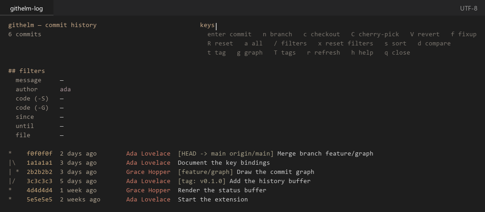

# Git Helm

[English](README.md) · **Русский** · [中文](README.zh.md)

Git-интерфейс для VS Code с клавиатуры, где каждый экран — настоящий текстовый буфер.

Ни деревьев, ни панелей, ни мыши. Вы открываете буфер статуса, ставите курсор и работаете одиночными клавишами: `s` — stage, `c` — коммит, `i` — в `.gitignore`. Буферы живут в области редактора, поэтому сплиты, поиск и обычные клавиши редактирования продолжают работать.

## Что умеет


*`alt+g` открывает его: `s` — stage, `d` — diff, `c` — коммит, `Ctrl+S` — записать коммит.*

| Экран | Возможности |
| --- | --- |
| **Статус** (`alt+g`) | индекс / изменения / неотслеживаемое / конфликты, stage файла, секции целиком или выделения, коммит, amend, stash, remotes, worktrees, fetch/pull/push, reset, abort merge, diff, открытие файла |
| **Diff** | stage или unstage чанка под курсором либо выделенных строк, `Enter` открывает файл на этой строке |
| **История** | ASCII-граф, детали коммита, ветка/checkout/cherry-pick/revert, fixup + автосквош, фильтры по сообщению/автору/дате и `git log -S` / `-G`, переключение сортировки, сравнение двух коммитов, reset на коммит |
| **Ветки** | локальные и удалённые (переключатель), upstream и расхождение, checkout / создание / переименование / удаление / set-upstream / merge / reset |
| **Теги** | список, показ коммита, создание, перенос на `HEAD`, удаление |
| **Коммит** | метаданные, stat и полный патч коммита, который вы пишете |
| **Файл** | `git log --follow` и `git blame` для текущего файла |
| **Конфликты** | взять ours / theirs / base для файла, отметить решённым или уйти во встроенный merge-редактор |
| **Лог действий** | каждый вызов `git`, сделанный расширением, со временем и кодом возврата |

## Установка

Нужны VS Code 1.85 или новее и `git` в `PATH`.

Из Marketplace: найдите **Git Helm** или выполните

```bash
code --install-extension <publisher>.githelm
```

Из VSIX:

```bash
code --install-extension githelm-X.Y.Z.vsix
```

Из исходников:

```bash
npm install
npm run build
```

Дальше либо `F5` (Extension Development Host), либо установка собранного пакета:

```bash
npx @vscode/vsce package --no-dependencies
code --install-extension githelm-X.Y.Z.vsix --force
```

Для быстрого цикла разработки удобнее не пересобирать VSIX, а подставить рабочую копию junction'ом:

```bat
mklink /J "%USERPROFILE%\.vscode\extensions\mercurykd.githelm" "D:\path\to\githelm"
```

затем `npm run build` → **Developer: Restart Extension Host**.

Имя папки должно быть `<publisher>.<name>`, как в манифесте: старая папка `local.githelm` (от прежнего имени паблишера) — это для VS Code **второе** расширение, и они дерутся за одни и те же команды и схемы. Удалите её: `rmdir "%USERPROFILE%\.vscode\extensions\local.githelm"`.

## Быстрый старт

`alt+g` открывает буфер статуса. Это единственная клавиша, которую нужно помнить: из него `g` открывает историю, `b` — ветки, `t` — теги, `S` — субмодули, `F` — pull request'ы, `l` — лог действий, `h` — справку по клавишам текущего экрана.

## Клавиши

Колонка `keys` на каждом экране — три строки и начинается под заголовком: длинные списки клавиш укладываются в эту высоту, а не растягивают колонку. На экранах-списках — теги, ветки и граф — она стоит ближе к тексту, чтобы за короткими строками не оставалось широкого пустого поля; на графе столько же места отдано блоку фильтров, поэтому он тоже начинается с шестой строки.


### Статус — `alt+g`

| Клавиша | Действие |
| --- | --- |
| `s` | stage: файл под курсором · вся секция, если курсор на заголовке · все файлы из выделения |
| `u` | unstage — те же три режима |
| `d` | diff файла под курсором — на заголовке секции диффится вся секция, каждый дополнительный курсор добавляет свой файл |
| `D` | отменить строку под курсором, слой за слоем (те же правила по курсору, что у `d`, но сначала подтверждение): **staged** возвращает индекс к HEAD, **unstaged** восстанавливает рабочую копию из индекса, **новый** файл удаляется с диска, **конфликт** получает версию из HEAD. Один и тот же файл может быть в нескольких секциях — каждая строка отменяется отдельно |
| `i` | добавить в `.gitignore`: файл под курсором · выделенные файлы · вся секция на заголовке (уже отслеживаемые не пишутся, а показываются в уведомлении — им нужен `git rm --cached`) |
| `Enter` | открыть файл |
| `c` | коммит: буфер сообщения, `Ctrl+S` — закоммитить |
| `m` | amend последнего коммита |
| `z` | спрятать в stash: если под курсорами есть файлы — только они, иначе список предложит `--staged` (только индекс) или `-u` (вместе с неотслеживаемыми) — не больше одного, а Enter без выбора прячет рабочее дерево целиком |
| `a` / `p` | применить / pop stash под курсором |
| `t` | создать тег: на коммите под курсором, если курсор на одном из последних коммитов, иначе на `HEAD` (`T` открывает экран тегов) |
| `A` | добавить remote (имя + URL) |
| `n` | добавить worktree: путь, затем ветка / тег / коммит (отсутствующая ветка создаётся от `HEAD`) |
| `W` | убрать worktree, у которых уже нет папки |
| `f` / `P` / `U` | fetch / pull / push |
| `R` | reset: выбрать soft/mixed/hard, затем `HEAD` или upstream |
| `M` | прервать идущий merge, revert или cherry-pick — спрашивает подтверждение, разрешённые конфликты будут потеряны |
| `x` | удалить stash / тег / remote / worktree под курсором; каждый спрашивает подтверждение, а удалённый стэш исчезает — список был единственным местом, где он лежал |
| `e` | изменить URL remote или перенести тег на `HEAD` |
| `b` | экран веток |
| `S` | экран субмодулей |
| `F` | открытые pull request / merge request репозитория — или страница создания нового |
| `g` | история коммитов |
| `r` | обновить |
| `h` | справка по текущему экрану |
| `q` | закрыть буфер |

Секции staged, unstaged и untracked видны всегда, даже пустые: исчезающая секция сдвигает все строки под собой и оставляет курсор на другом файле. Пропадает только conflicts — его отсутствие и есть нормальное состояние.

В шапке статуса — ветка и её расхождение с upstream (`origin/main: +2 −1`: только те счётчики, что не равны нулю), `HEAD`, репозиторий, remote для push и подсказки клавиш экрана — три строки по четыре клавиши. Блоки `remotes`, `worktrees` и `stash` делят одну колонку справа, именно в этом порядке, рядом с файловыми секциями: файлам остаётся левая половина, между половинами шесть колонок отступа, два блока колонки разделяет пустая строка — как и в левой половине, а сама колонка начинается под списком клавиш, на уровне `staged`. Заголовок колонки может делить строку с заголовком файловой части (`## staged` рядом с `## remotes`) — какая из двух секций отзовётся на клавишу, решает колонка курсора.

Каждая подсказка экрана укладывается в одну строку: колонка шириной в свою самую длинную подсказку (подсказку worktrees), так что список клавиш не приходится читать в двух местах. Блок `remotes` перечисляет все remote'ы с URL, блок «последние коммиты» показывает сообщение, автора и дату.

Блок `stash` перечисляет стэши и рисуется даже тогда, когда их нет: его клавиши (`z stash`, `enter files`, `d diff`, `a apply`, `p pop`, `x drop`) — единственное место в буфере статуса, где сказано, как сделать первый. `z` решает, что прятать, по курсорам: файлы под ними уходят в стэш и только они — вопрос не задаётся. Курсор на заголовке секции прячет всю секцию; если под курсором файлов нет, список предложит `--staged` (только индекс) и `-u` (вместе с неотслеживаемыми) — не больше одного, а Enter без выбора прячет рабочее дерево. По умолчанию не включено ничего: неотслеживаемый файл попадёт в стэш только с `-u`.

Ничто, что удаляет или прячет, не происходит без вопроса: `D` discard, `x` удалить (стэш, тег, remote, worktree), `x` на экранах веток и тегов, `D` на экране веток для удалённой ветки, hard reset по `R`/`S`, `V` revert, `M` прервать, `c` очистить лог действий. `p` pop не спрашивает: он сначала применяет стэш и только потом убирает запись, так что изменения уже в рабочем дереве.

Блок `worktrees` перечисляет все чекауты репозитория, `*` — тот, к которому относится буфер; колонка курсора решает, к какой строке относится клавиша. `Enter` на строке переключает на этот worktree (у него свой статус-буфер), `Shift+Enter` открывает эту папку в новом окне, `Alt+Enter` перезагружает текущее окно на ней (спрашивает подтверждение — текущая папка, раскладка и несохранённые редакторы будут потеряны), `n` добавляет новый, `x` удаляет worktree под курсором: грязный спрашивает про `--force`, текущий удаляется только из другого worktree, а `W` вычищает записи, чьих папок уже нет. Когда активный буфер принадлежит связанному worktree, статус-бар показывает его имя рядом с веткой.

Колонка автора общая с графом истории: её ширина = самый длинный логин + два символа, поэтому сообщения стоят ровно друг под другом на обоих экранах, без фиксированного зазора.

### Diff

| Клавиша | Действие |
| --- | --- |
| `s` | stage: без выделения — **весь чанк под курсором**, с выделением — только выбранные строки |
| `u` | unstage — те же правила, в staged-диффе |
| `Enter` | открыть файл на этой строке |
| `r` | обновить |
| `q` | закрыть |

### История



*`g` открывает граф: `Enter` — коммит, `/` — фильтры, `a` — все ветки, `f` — fixup в коммит.*

| Клавиша | Действие |
| --- | --- |
| `Enter` | показать коммит (метаданные, stat, патч) |
| `n` | создать ветку от коммита |
| `t` | создать тег на коммите под курсором — новая ссылка сразу видна в строке |
| `c` | checkout ветки этого коммита |
| `C` | cherry-pick коммита на текущую ветку |
| `V` | отменить коммит: новый коммит с обратными изменениями (с подтверждением; у merge-коммита спрашивается основной родитель; конфликт прерывается клавишей `M` на экране статуса) |
| `f` | fixup staged-изменений в этот коммит + автосквош |
| `R` | reset на коммит (soft/mixed/hard) |
| `a` | переключить «все ветки» |
| `/` | фильтры: сообщение, автор, диапазон дат, `git log -S` / `-G` |
| `x` | сбросить фильтры |
| `s` | переключить сортировку (topo / date / author date) |
| `d` | сравнить коммиты: один даёт `<commit>..HEAD`, два — `A..B` или `A...B` с пометками left/right; в меню есть оба направления (`B..A`) и для diff, и для графа истории |
| `g` | открыть граф — клавиша работает в любом буфере githelm, а экраны статуса, веток, тегов, субмодулей и лога действий показывают её в подсказках |
| `T` | экран тегов |
| `r` | обновить |

### Ветки

| Клавиша | Действие |
| --- | --- |
| `c` (или `Enter`) | checkout — одна команда на две клавиши; подсказка называет `c`, чтобы одно действие не значилось дважды |
| `n` | создать |
| `e` | переименовать |
| `u` | задать upstream |
| `x` | удалить |
| `D` | удалить удалённую ветку |
| `m` | merge в текущую ветку |
| `S` | reset ветки (soft/mixed/hard) |
| `R` | переключить локальные/удалённые |
| `g` | открыть граф |
| `T` | экран тегов |
| `r` | обновить |

### Теги

| Клавиша | Действие |
| --- | --- |
| `Enter` | показать коммит тега |
| `t` | создать тег на `HEAD`; с сообщением он станет annotated — та же клавиша, что на экране статуса и в графе |
| `e` | перенести тег на `HEAD` |
| `x` | удалить |
| `D` | удалить тег на remote — локальный тег остаётся |
| `U` | отправить тег в remote |
| `g` | открыть граф |
| `r` | обновить |

Обновление тега никогда не бывает fast-forward, поэтому push тега — всегда принудительный, и этот force *взят в аренду*: `U` сначала спрашивает у remote, куда тег указывает там, и отправляет это значение как ожидаемое. Тег, который за это время сдвинул кто-то другой, будет отклонён, а не перезаписан. Тег, которого на remote ещё нет, отправляется вообще без force.

Строка — это строка коммита с экрана истории, только на месте графа стоит имя тега: имя, короткий sha, дата, автор, тема, в тех же колонках и тех же цветах. Аннотированный тег показывает своё сообщение в отдельной колонке сразу после имени, а тема коммита остаётся в конце строки. Список начинается с шестой строки: три строки под заголовком занимают подсказки клавиш, ещё одна отделяет их от строк. У lightweight-тега сообщения нет, поэтому эта колонка остаётся пустой.

### Субмодули — `S`

| Клавиша | Действие |
| --- | --- |
| `Enter` | открыть субмодуль как отдельный репозиторий: у него свой буфер статуса, где его изменения индексируются, диффятся и коммитятся |
| `u` | переключить субмодуль на коммит, записанный в родителе (`git submodule update --init`) |
| `U` | подтянуть до головы ветки из `.gitmodules` (`git submodule update --init --remote`) |
| `g` | открыть граф |
| `T` | экран тегов |
| `r` | обновить |

В каждой строке — тот же маркер, что печатает `git submodule status`: пробел, когда checkout совпадает с записанным коммитом, `+` — субмодуль на другом коммите, `-` — не инициализирован, `U` — конфликт. Экран показывает и вложенные субмодули, а в буфере статуса строка gitlink помечается `sub` (`sub+`, если checkout уехал), чтобы изменение субмодуля не выглядело обычным файлом.

### Pull request'ы — `F`

`F` показывает открытые pull request'ы (GitHub) или merge request'ы (GitLab) и открывает выбранный в браузере; первый пункт — страница создания нового. Forge определяется по URL remote: `git@github.com:owner/repo.git`, `ssh://…`, `https://…`, подгруппы GitLab (`group/sub/project`) — всё понимается, а `githelm.forge.kind` задаёт forge вручную, когда у self-hosted хоста нейтральное имя.

Для списка нужен токен, потому что его требует API: fine-grained токен GitHub с `Pull requests: read` или токен GitLab с `read_api` — в настройках либо в `GITHUB_TOKEN` / `GITLAB_TOKEN`. Без токена `F` так и говорит и предлагает открыть настройки, а не молчит. Создание запроса токена не требует: страница открывается в браузере, где вы уже авторизованы. База — то, на что указывает `origin/HEAD`, иначе `main`.

### Git LFS

LFS хранит большие blob'ы на своём сервере, а в коммит кладёт маленький файл-указатель. В статусе такие строки получают метку `lfs`, а дифф, содержащий указатель, начинается с пояснения, что oid и размер — всё, что git может показать, а содержимое приходит из `git lfs pull`. Распознавание — текстовая проверка (`version https://git-lfs.github.com/spec/v1` плюс `oid` и `size`), поэтому работает и без установленного клиента LFS; без клиента вызов `git lfs ls-files` просто ничего не возвращает, и меток нет.

### Конфликты

| Клавиша | Действие |
| --- | --- |
| `o` | взять ours |
| `T` | взять theirs — единственный экран, где `T` не открывает теги |
| `B` | взять base |
| `m` | открыть merge-редактор VS Code |
| `s` | отметить решённым |

### Общие

| Клавиша | Действие |
| --- | --- |
| `alt+g` | буфер статуса |
| `l` | лог действий |
| `q` | закрыть буфер |
| `h` | справка по клавишам |

## Сообщения

Подтверждение или подсказка («Staged: 2», «Cursor is not on a file or a section header») появляется в
статус-баре на четыре секунды и исчезает. Отказ («Cannot delete the branch you are on») дополнительно
показывается уведомлением, а ошибка — команда git ответила ошибкой, патч не применился, буфер не
восстановился при запуске — пишется в выходной канал **Git Helm** вместе со стеком *и* дублируется
уведомлением: ошибка не должна остаться строкой, которая погасла раньше, чем её прочли. Детали
остаются в канале, уведомление несёт само сообщение.

## Папка без репозитория

`alt+g` не ругается вне git-репозитория: буфер статуса открывается с секцией `init`. `Enter` на строке `git init` (или кнопка в уведомлении, или элемент `git init` в статус-баре) создаёт репозиторий и перерисовывает тот же буфер. Репозиторий без коммитов (`git init`, пустая история) открывается нормально — лог просто пустой.

## Палитра и настройки

В палитре намеренно видны три команды: **Git Helm: Status**, **Git Helm: Actions for Current File** и **Git Helm: Interface Language**. Остальные скрыты — интерфейс это клавиши в буфере, а действия, уместные при правом клике, вынесены в контекстное меню редактора.

Язык интерфейса — `en`, `ru` или `zh`; выбор хранится у пользователя и применяется ко всем буферам сразу.

| Настройка | По умолчанию | Смысл |
| --- | --- | --- |
| `githelm.log.dateFormat` | `%Y-%m-%d %H:%M` | формат даты в истории, передаётся в `git --date=format:…` |
| `githelm.ui.hintColumn` | `94` | колонка, с которой начинаются подсказки клавиш справа — для очень широких окон её стоит увеличить |
| `githelm.log.includeAllRefs` | `false` | показывать в истории все ref'ы, включая `refs/stash` и созданные другими инструментами |
| `githelm.forge.kind` | `auto` | `auto` / `github` / `gitlab` — в режиме `auto` forge берётся из имени хоста remote |
| `githelm.forge.githubToken` | — | токен GitHub для списка pull request'ов; иначе берётся `GITHUB_TOKEN` |
| `githelm.forge.gitlabToken` | — | токен GitLab для списка merge request'ов; иначе берётся `GITLAB_TOKEN` |

Все цвета учитывают тему и переопределяются через `workbench.colorCustomizations`. Значения по умолчанию — тёплая, мелованная «карандашная» палитра: матча для добавлений, мёд для изменений, ройбуш для удалений, корица для хешей, розовый чай для авторов, улун для ссылок; для тёмной и светлой темы значения разные (все, кроме декоративных линий графа, проходят контраст WCAG AA на фоне редактора):

```json
{
  "workbench.colorCustomizations": {
    "githelm.added": "#92a271",
    "githelm.deleted": "#c56f62",
    "githelm.graph": "#8a8073"
  }
}
```

Секция — один цвет: заголовок и пути её строк делят его — `githelm.staged` шалфей, `githelm.unstaged` мёд, `githelm.untracked` коралл, `githelm.conflict` при конфликте слияния, — поэтому «уже в индексе» читается прямо по списку. `githelm.section` остаётся нейтральным для заголовков без своей секции (стэш, последние коммиты, остальные буферы), а блоки `remotes` и `worktrees` в правой колонке делят `githelm.remotes` — у `githelm.worktrees` то же значение, потому что они стоят друг под другом и читаются одним блоком; блок `stash` под ними остаётся нейтральным `githelm.section`. Та же яркость у списка файлов в стэше и у путей сабмодулей (`githelm.path`), а маркер `##`, линия под подсказками и хвостовые пометки остаются тихими (`githelm.rule`, `githelm.meta`); сами подсказки — серые, как комментарии (`githelm.help`). В метке расхождения `+ahead` идёт цветом добавлений, `−behind` — цветом удалений, поэтому направление видно сразу.

Текст строки не красится вовсе и остаётся текстом редактора: сообщение стэша, URL remote и путь рабочего дерева читаются с тем же весом, что и тема коммита в буфере истории. Цветом остаётся то, чем строка является: ссылка стэша, имя remote и короткий хеш держат `githelm.branch`, а сопоставление ветки с remote (`origin/main: +2 −1`) получает свой коралл `githelm.upstream`, чтобы его не путали ни с URL над ним, ни с ссылкой коммита.

Доступные id: `githelm.added`, `githelm.modified`, `githelm.deleted`, `githelm.conflict`, `githelm.hash`, `githelm.date`, `githelm.author`, `githelm.refs`, `githelm.upstream`, `githelm.graph`, `githelm.hunk`, `githelm.meta`, `githelm.path`, `githelm.section`, `githelm.staged`, `githelm.unstaged`, `githelm.untracked`, `githelm.remotes`, `githelm.worktrees`, `githelm.branch`, `githelm.help`, `githelm.rule`.

## Разработка

Нужен Node 22.8+: `npm test` использует флаг тест-раннера `--experimental-test-isolation`, который старые версии отвергают. В CI стоит Node 24.

```bash
npm run build        # компиляция в dist/ и копирование шимов git-редактора
npm run watch        # пересборка на лету
npm run typecheck    # tsc --noEmit
npm test             # сборка расширения и тестов, проверка манифеста, запуск набора
```

`npm test` — это **415 тестов** (410 проходят, 5 пропущены) на настоящих временных git-репозиториях: бинарник `git` не мокается. Та же команда запускает `npm run validate` — она падает, если клавиша или пункт меню ссылаются на неизвестную команду, либо если отсутствуют `main`, иконка, шимы, `CHANGELOG.md` или один из README, либо в README пропала ссылка на другой язык.

Скриншоты в этом README — не снимки окна: `scripts/make-screenshots.mjs` спрашивает настоящие `renderStatus` и `renderLog` про текст и спаны, а `scripts/make-screenshots.py` рисует их значениями из `contributes.colors` и картой спанов в `views/highlight.ts`. Руками нарисована только рамка — полоса вкладки и каретка, — поэтому картинка не может показать раскладку или цвет, которых буферы на самом деле не выдают.

## Релизы

Тег вида `v*` публикует расширение сам: workflow прогоняет тесты, собирает один VSIX, публикует этот файл в [VS Code Marketplace](https://marketplace.visualstudio.com/items?itemName=mercurykd.githelm) и в [Open VSX](https://open-vsx.org/extension/mercurykd/githelm), и прикладывает его к релизу на GitHub — то есть все получают одну и ту же сборку.

```bash
npm version patch -m "release %s"   # версия, коммит и тег
git push --follow-tags              # тег публикует релиз
```

Тег можно сделать и из редактора: `t` на экране тегов спрашивает сообщение — именно оно делает тег annotated, — а `U` отправляет его в remote. Версию в `package.json` всё равно нужно поднять вручную — это единственное, что `npm version` делает за вас.

В Marketplace публикация идёт по trusted publishing, токен не хранится. В Open VSX публикуется секретом `OVSX_PAT` — до тех пор, пока там не зарегистрирован trusted publisher для этого репозитория.
## Архитектура

```
src/
  extension.ts        команды, статус-бар, активация
  git/                тонкие типизированные обёртки над git CLI (status, log, diff,
                      stage, stash, tags, remotes, ops, rewrite, conflicts, compare, …)
  views/              по модулю на буфер: status, diff, log, branches, tags,
                      submodules, commit, conflict, stash, action log, file
                      history, compare
  forge/              GitHub / GitLab: разбор URL remote и запросы к REST API
  views/columns.ts    правая колонка подсказок, общая для всех экранов
  views/highlight.ts  цветовые спаны из темы
  i18n/               словари en / ru / zh с общим набором ключей
  fs/                 редактируемые виртуальные документы (сообщения коммитов)
  rebase/             мост GIT_EDITOR для интерактивного ребейза
  util/               помощники процессов, спаны
media/shims/          шимы git-редактора для rebase-моста
```

Буферы — виртуальные документы схемы `githelm:`: текст только для чтения, с которым работают обычные возможности редактора — поиск, сплиты, миникарта, навигация, сворачивание. Правки применяются перерисовкой документа, а не патчем редактора, поэтому буфер всегда показывает то, что реально сообщает git.

## Ограничения

- Один репозиторий за раз: первый найденный от активного буфера (или корень workspace).
- Fixup и автосквош идут через мост `GIT_EDITOR`: todo-лист можно править, но прогресса по шагам нет, и конфликт посреди ребейза не ведётся.
- Разрешение конфликтов — пофайловое (ours / theirs / base) или через merge-редактор; трёхстороннего редактора на уровне ханков нет.
- Diff stash'а — пофайловый: применить отдельный ханк из stash нельзя.
- Поддержка LFS — это распознавание, а не клиент: файлы-указатели получают метку и пояснение в диффе, но сами blob'ы по-прежнему качает `git lfs pull` в терминале.
- Pull request'ы показываются через API и создаются в браузере; расширение не комментирует, не ревьюит и не мержит.
- Тесты — юнит-уровня на настоящих git-репозиториях; интеграционных тестов в extension host в CI нет.

## Лицензия

MIT — см. [LICENSE](LICENSE).
