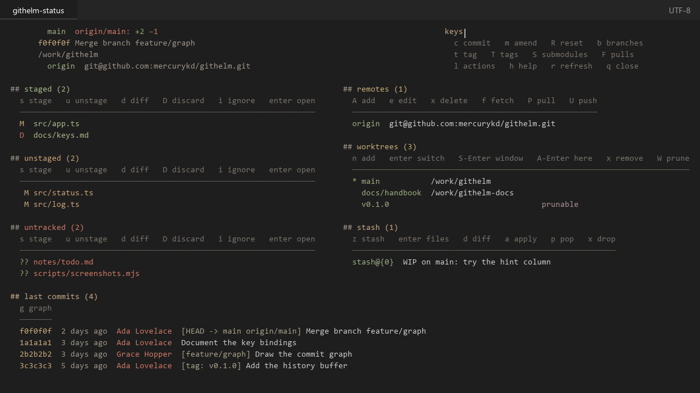
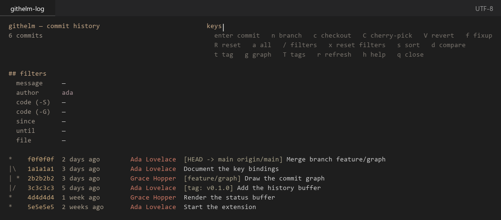

# Git Helm

[English](README.md) · [Русский](README.ru.md) · **中文**

一个键盘驱动的 VS Code Git 界面，由 webview 面板绘制。

每个界面都是一个 webview 面板：没有树形视图，也不需要用鼠标，更没有需要同步的第二套界面。你打开状态界面，移动光标，用单个按键操作 —— `s` 暂存，`c` 提交，`i` 把文件加入 `.gitignore`。面板与缓冲区都在编辑器区域里，所以分屏、搜索和普通的编辑快捷键都照常工作。

## 功能



*`alt+g` 打开它：`s` 暂存，`d` 差异，`c` 提交，`Ctrl+S` 写入提交。*

| 界面 | 亮点 |
| --- | --- |
| **状态** (`alt+g`) | 已暂存 / 未暂存 / 未跟踪 / 冲突，暂存单个文件、整个区块或选中内容，提交、amend、stash、remotes、worktrees、本地分支区块（切换 / 创建 / 合并 / 图形 / reset）、最近提交操作（打开、分支、切换、拣选、还原、修补、reset、标签）、fetch/pull/push、abort merge、diff、打开文件 |
| **Diff** | 暂存或取消暂存光标处的 hunk，或选中的行；`Enter` 在该行打开文件 |
| **历史** | ASCII 图形、提交详情、分支/checkout/cherry-pick/revert、fixup + autosquash、按消息/作者/分支/日期筛选以及 `git log -S` / `-G`、切换排序、比较两个提交、reset 到某个提交 |
| **分支** | 本地与远程（可切换）、upstream 与领先/落后、checkout / 新建 / 重命名 / 删除 / set-upstream / merge / reset，`G` 打开单个分支的图 |
| **标签** | 列表、查看提交、新建、移动到 `HEAD`、删除 |
| **提交** | 正在编写的提交的元数据、stat 和完整 patch |
| **文件** | 当前文件的 `git log --follow` 和 `git blame` |
| **冲突** | 按文件选择 ours / theirs / base，标记为已解决，或进入内置的合并编辑器 |
| **操作日志** | 扩展执行的每一次 `git` 调用，含耗时和退出码 |

## 安装

需要 VS Code 1.85 或更高版本，以及 `PATH` 中可用的 `git`。

从 Marketplace 安装：搜索 **Git Helm**，或者

```bash
code --install-extension <publisher>.githelm
```

从 VSIX 安装：

```bash
code --install-extension githelm-X.Y.Z.vsix
```

从源码安装：

```bash
npm install
npm run build
```

然后按 `F5`（Extension Development Host），或者安装打包好的构建。启动配置传入 `--disable-extensions`：dev host 中已安装的扩展保持不启用，因此已安装的 Git Helm 不会与正在开发的副本冲突——打开其他文件夹后也一样。

```bash
npx @vscode/vsce package --no-dependencies
code --install-extension githelm-X.Y.Z.vsix --force
```

如果想快速迭代，可以把工作副本链接进 VS Code，而不是每次重新打包：

```bat
mklink /J "%USERPROFILE%\.vscode\extensions\mercurykd.githelm" "D:\path\to\githelm"
```

然后 `npm run build` → **Developer: Restart Extension Host**。

文件夹名必须是 `<publisher>.<name>`，与清单一致：改名之前留下的 `local.githelm` 目录对 VS Code 来说是**第二个**扩展，两者会争抢同样的命令和 scheme。请删除它：`rmdir "%USERPROFILE%\.vscode\extensions\local.githelm"`。

## 快速开始

`alt+g` 打开状态界面。这是你唯一需要记住的快捷键：从它出发，`g` 打开历史，`b` 打开分支，`t` 打开标签，`S` 打开子模块，`F` 打开 pull request，`l` 打开操作日志。

每个屏幕都是一个 webview 面板：没有可切换的界面，也没有模式设置。子界面同样是面板 —— 单个提交、stash 的文件列表、冲突和文件历史（日志）—— 各自由自己的渲染器绘制（见 [docs/webview-status.md](docs/webview-status.md)）。面板中的每个 diff 都是 VS Code 自带的 diff 编辑器：多选会打开一个 multi-diff 标签页，而提交或 stash 中的文件会把它的父提交与它本身对比，所以任何地方都没有生成的补丁视图。每个标签页都按内置 git 的写法标注：`src/a.ts (索引)`、`src/a.ts (工作区)`、`src/a.ts (未跟踪)` 或 `src/a.ts (a1b2c3d) ↔ src/a.ts (dc3ba5e)`。这个编辑器工具栏上还有两个箭头，把 diff 本身沿历史步进 —— 后退一个提交、前进一个提交（`alt+[` / `alt+]`），见[按提交步进 diff](#按提交步进-diff)。在提交上按 `Enter` 会打开独立屏幕：谁在何时提交、提交信息是什么、改动了哪些文件，`d` 打开光标所在文件的 diff —— 点击 `## files` 标题则打开全部文件的 diff。Blame 就是文件本身：它以自身的代码在真正的编辑器中打开 —— 相同的行、由该文件的语言高亮、宽度取最长的一行，元数据以装饰的形式绘制在每一行之前：固定宽度的左栏给出 sha、作者、日期和提交主题（每个区块一次），代码从它下面滚过而不会被它挤开。把指针停在行上，VS Code 会用自带的悬停提示显示完整提交信息（含正文）。Blame 是唯一在两种模式下都不使用面板的屏幕，因为 webview 没有可以高亮代码的语法。

## 按键

所有界面的头部都是同一个样子：一行写明这个界面 —— 仓库、破折号、界面名（`D:/work/app — 分支`）—— 而本界面的按键自成一栏，从面板正中开始，所以任何界面上第一个按键都在同一位置；按键在这一栏里换行，满宽面板上是三行。头部下面只隔一行空白，没有线。头部在所有界面都是同一形状、同样高度，状态界面也不例外：它对自身位置的说明放在头部下面，作为这一栏的第一个区块 —— 两行，带跟踪状态的分支和 `HEAD`。没有界面在头部数自己的行：计数在区块标题里（`## local (2)`），而行本身就是列表。提示按 `按键 动作` 成对打印，上面没有 `keys` 标题；面板窄于 820 像素时，按键会回到标题下面、占满整宽，而不是把两栏挤在一起。


### 状态 —— `alt+g`

| 按键 | 动作 |
| --- | --- |
| `s` | 暂存：光标处的文件 · 光标在标题上时整个区块 · 选中范围内的所有文件 |
| `u` | 取消暂存 —— 同样三种模式 |
| `alt+s` | 全部暂存：整个仓库，包括删除 |
| `alt+u` | 全部取消暂存：把索引里的所有内容移出 |
| `d` | 光标处文件的 diff — 在分区标题上则取整个分区，每个额外光标再加一个文件 |
| `D` | 放弃光标处的那一行，按层处理（光标规则与 `d` 相同，且会先确认）：**已暂存**行把索引恢复到 HEAD，**未暂存**行从索引恢复工作区，**新文件**从磁盘删除，**冲突**采用 HEAD 版本。同一文件可能同时出现在多个分区 —— 每行各自独立处理 |
| `i` | 加入 `.gitignore`：光标处的文件 · 选中的文件 · 光标在标题上时整个区块（已跟踪的文件只会被报告出来 —— 它们需要 `git rm --cached`） |
| `Enter` | 打开文件 |
| `c` | 提交：消息缓冲区，`Ctrl+S` 提交 |
| `m` | amend 上一次提交 |
| `z` | stash：光标下有文件时只 stash 这些文件，否则弹出列表选择 `--staged`（仅暂存区）或 `-u`（连同未跟踪文件）—— 最多选一项，什么都不选直接 Enter 则 stash 整个工作区 |
| `a` / `p` | apply / pop 光标处的 stash |
| `t` | 创建标签：光标位于最近的提交上时作用于该提交，否则作用于 `HEAD`（`T` 打开标签界面） |
| `A` | 添加 remote（名称 + URL） |
| `n` | 添加 worktree：先路径，再分支 / 标签 / 提交（分支不存在时从 `HEAD` 创建） |
| `W` | 清理目录已消失的 worktree 记录 |
| `f` / `P` / `U` | fetch / pull / push |
| `R` | reset：一个模式选择器，提示为 `重置到 HEAD`——选择 soft/mixed/hard 后立即执行 |
| `M` | 中止进行中的 merge、revert 或 cherry-pick —— 会先确认，已解决的冲突将丢失 |
| `x` | 删除光标处的 stash / 标签 / remote / worktree；每一项都会先确认，而被删除的 stash 就没了 —— 这个列表是它唯一的所在 |
| `e` | 修改 remote 的 URL，或把标签移动到 `HEAD` |
| `b` | 分支界面 |
| `S` | 子模块界面 |
| `F` | 仓库的 pull request / merge request —— 或创建新请求的页面 |
| `g` | 提交历史 |
| `r` | 刷新 |
| `q` | 关闭面板 |

`staged`、`unstaged`、`untracked` 三个区块始终显示，即使为空：消失的区块会把下面的行整体上移，让光标落到另一个文件上。只有 `conflicts` 随状态出现和消失，因为没有冲突才是常态。

状态头部是 `D:/work/app — 状态` —— 路径、破折号、界面名，按键提示在从面板正中开始的那一栏里，与其他界面完全一样；它下面、作为这一栏的第一个区块，是两行：带与 upstream 差距的分支（`origin/main: +2 −1`，为零的计数不显示）和 `HEAD`。仓库已经是标题自己的词，remote 是它自己的区块，所以这两行里不再重复它们。`remotes`、`worktrees`、`stash` 三个区块在右侧共用一栏，顺序如上，紧挨文件区块：左侧半屏留给文件，两半之间留出六列间距，栏内两个区块之间空一行（与左半部分一致）。栏内标题可以与文件侧的标题共处一行（`## staged` 挨着 `## remotes`）；按键作用于哪个区块，由光标所在的列决定。

每条提示都是 `按键 动作` 一对，面板变窄时整行换行：头部与面板同宽，因此按键列表不必分两处阅读。`remotes` 区块列出每个 remote 及其 URL，“最近的提交”区块总是显示消息、作者和日期，而提交的标签与分支是它消息的最前面几个词（`[HEAD -> main tag: v0.0.4] feat: …`）：标签是消息的一部分，不是一栏，所以长消息在消息栏里换行，标签也不会被截断。

状态界面下半部分是两个区块：左边的 `## branches (n)` 和右边的 `## last commits (n)`，提交区块占 60% 宽度。分支区块只列出本地分支——当前分支标有 `*`，并带有跟踪标签和最后一次提交的主题。选中分支行时，它使用分支界面的按键：`Enter` 或 `c` 切换分支，`n` 从所选分支创建新分支，`m` 把它合并进当前分支，`R` 重置到该分支（一个模式选择器，提示为 `重置到 <name>`），`G` 打开该分支的图形。提交行同样可选，并使用历史界面的按键：`Enter` 打开提交，`n` 从该提交创建分支，`c` 切换其分支（如果没有分支指向该提交，则直接以分离 HEAD 检出该提交），`C` 拣选，`V` 还原，`f` 修补，`R` 重置到该提交，`t` 打标签；`g` 仍然打开全部历史。在其他行上同样的键保持状态含义（`c` 提交、`m` 修补、`n` 添加 worktree），所以由光标所在行决定，每个区块的提示行会说明当前是哪种读法。

`stash` 区块列出仓库里的 stash，即使一个都没有也会绘制：它的按键（`z stash`、`enter files`、`d diff`、`a apply`、`p pop`、`x drop`）是状态缓冲区里唯一说明如何创建第一个 stash 的地方。`z` 依据光标决定 stash 什么：光标下的文件进入 stash，且只有这些文件 —— 不会再提问。光标停在区块标题上则整个区块进入 stash；光标下没有文件时会列出 `--staged`（仅暂存区）和 `-u`（连同未跟踪文件），最多选一项，什么都不选直接 Enter 则 stash 整个工作区。默认什么都不开：未跟踪文件只有在 `-u` 时才会进入 stash。

任何删除或丢弃操作都会先提问：`D` discard、`x` 删除（stash、标签、remote、worktree）、分支与标签界面上的 `x`、分支界面上删除远程分支的 `D`、`R` hard reset、`V` revert、`M` 中止、`c` 清空操作日志。`p` pop 不问：它先应用 stash 再删除记录，改动已经在工作区里。

`worktrees` 区块列出仓库的每一个检出，`*` 标出面板所属的那一个；光标所在的列决定按键作用于哪一行。在行上按 `Enter` 切换到该 worktree（它自己的状态缓冲区），`Shift+Enter` 在新窗口中打开该目录，`Alt+Enter` 在当前窗口重新加载该目录（会先确认 —— 当前目录、布局和未保存的编辑器都会丢失），`n` 新增，`x` 删除光标处的 worktree —— 有未提交改动时会询问是否使用 `--force`，而不是直接失败；当前 worktree 只能从另一个 worktree 中删除。`W` 清理目录已经不存在的记录。当活动缓冲区属于一个关联的 worktree 时，状态栏会在分支旁显示它的名字。

作者列与历史图形共用：宽度 = 最长的登录名加两个字符，所以两个界面上的提交消息能对齐，而不是留一个固定的间隙。

### Diff

| 按键 | 动作 |
| --- | --- |
| `s` | 暂存：没有选区时是**光标处的整个 hunk**，有选区时只暂存这些行 |
| `u` | 取消暂存 —— 同样的规则，作用于已暂存的 diff |
| `Enter` | 在该行打开文件 |
| `r` | 刷新 |
| `q` | 关闭 |

### 历史



*`g` 打开图：`Enter` 查看提交，`/` 过滤，`a` 所有分支，`f` fixup 到某个提交。*

| 按键 | 动作 |
| --- | --- |
| `Enter` | 打开提交屏幕：作者、日期、提交信息以及改动的文件 |
| `n` | 从该提交新建分支 |
| `t` | 为光标所在的提交创建标签 —— 新引用会立即显示在该行 |
| `c` | checkout 该提交所在的分支——如果没有分支指向该提交，则直接以分离 HEAD 检出该提交 |
| `C` | 把该提交 cherry-pick 到当前分支 |
| `V` | revert 该提交：生成一个抵消它的新提交（会先确认；合并提交会询问主线父提交；冲突可以回到状态界面按 `M` 中止） |
| `f` | 把已暂存的改动 fixup 进该提交，然后 autosquash |
| `R` | reset 到该提交：一个模式选择器，提示为 `重置到提交 <sha>` |
| `a` | 切换显示全部分支 |
| `/` | 筛选：消息、作者、分支、日期范围、`git log -S` / `-G` |
| `x` | 清除筛选 |
| `s` | 切换排序（topo / date / author date） |
| `d` | 比较提交：一个提交给出 `<commit>..HEAD`，两个给出 `A..B` 或 `A...B` 并带 left/right 标记；菜单里 diff 和图历史都提供两个方向（`B..A`） |
| `g` | 打开图 —— 在任何 githelm 界面都可按下，状态、分支、标签、子模块和操作日志界面的提示行会把它列出 |
| `T` | 标签界面 |
| `r` | 刷新 |

`Enter` 打开的提交界面保留 `d`（对所选文件的全部改动），并新增 `t` —— 同一批文件在该提交之后的样子：每个文件一个只读标签页，这样就能在不切换工作区的情况下读取旧版本的文件。

`分支` 筛选按 `git log <branch>` 的方式读取单个分支的历史：它收窄遍历范围，而不是并入其中。它可以接受本地分支、`origin/main`、标签或 sha，并且优先于 `a` —— 后者的所有引用并集会把这些分支重新放回来。输入分支会关掉 `a`；而在设了分支时按 `a` 会清除筛选并打开所有引用 —— 遍历由最后提出的那个决定，因此标题不会把只给了一条分支的历史说成「所有分支」。解析不到的名称会得到一条提示（输入框回到仍在生效的筛选），而不是一页 `fatal: ambiguous argument`。比较一个区间会清除分支筛选，因为此时由区间决定遍历。

### 分支

| 按键 | 动作 |
| --- | --- |
| `c`（或 `Enter`） | checkout —— 一个命令两个键；提示行只写 `c`，同一个动作不会出现两次 |
| `n` | 新建 |
| `e` | 重命名 |
| `u` | 设置 upstream |
| `x` | 删除 |
| `D` | 删除远程分支 |
| `m` | merge 到当前分支 |
| `d` | 比较 —— 一个分支与 `HEAD`，或两个分支互相比较；`diff …` 打开补丁，`log …` 打开该范围的图 |
| `R` | reset 分支：一个模式选择器，提示为 `重置到 <name>` |
| `a` | 切换本地/远程分支 |
| `g` | 打开图 |
| `G` | 打开光标所在分支的图：历史界面直接带着已填好的 `分支` 筛选打开 —— 本地分支、远程分支、标签或 sha 都行，用的是同一个字段、同一条 `git log <branch>` |
| `T` | 标签界面 |
| `r` | 刷新 |

`G` 是图键的「大写版」，就像每个界面上的大写字母那样：`g` 打开全部历史，`G` 打开同一个界面、只问一条分支。没有任何东西被复制到第二个视图：面板把分支名交给它本来就有的 `分支` 筛选，所以读者看到的是 `git log <branch>` 给出的历史，可以打开提交，也可以清空字段把范围放宽。行里可能是远程分支（`origin/main`）或标签：名字就是 `git rev-parse` 能解析的那个，和在字段里输入完全一样。

### 标签

| 按键 | 动作 |
| --- | --- |
| `Enter` | 显示标签指向的提交 |
| `t` | 在 `HEAD` 上创建标签；填写说明会创建附注标签 —— 与状态界面和图中的按键一致 |
| `e` | 把标签移动到 `HEAD` |
| `x` | 删除 |
| `D` | 删除远程上的标签 —— 本地标签保留 |
| `U` | 把标签推送到远程 |
| `g` | 打开图 |
| `r` | 刷新 |

标签的更新永远不是快进，因此推送标签总是强制更新 —— 而这个强制是*带租约*的：`U` 先问远程该标签指向哪里，再把这个值作为期望值发过去。若期间别人移动过该标签，推送会被拒绝而不是覆盖。远程还没有的标签则完全不需要强制。

每一行就是历史界面的提交行，只是图的位置换成了标签名：名称、短 sha、日期、作者、主题，列和颜色都相同。附注标签在名称之后单独一列显示它自己的说明，提交主题仍保留在行尾。各行紧接在头部之后：界面名、按键提示、一条线和一行空白，然后就是列表。轻量标签没有说明，因此该列留空。

### 子模块 —— `S`

| 按键 | 动作 |
| --- | --- |
| `Enter` | 把子模块当作独立仓库打开：它有独立的状态界面，改动在那里被暂存、对比和提交 |
| `u` | 把子模块切换到父仓库记录的提交（`git submodule update --init`） |
| `U` | 更新到 `.gitmodules` 中配置的分支最新（`git submodule update --init --remote`） |
| `g` | 打开图 |
| `T` | 标签界面 |
| `r` | 刷新 |

每行的标记与 `git submodule status` 一致：空格表示当前检出与记录的提交相同，`+` 表示位于其他提交，`-` 表示未初始化，`U` 表示冲突。界面也会列出嵌套子模块；状态缓冲区把 gitlink 行标记为 `sub`（检出移动时为 `sub+`），这样子模块的改动不会被当成普通文件。

### Pull request —— `F`

`F` 列出 remote 上打开的 pull request（GitHub）或 merge request（GitLab），选中后在浏览器中打开；第一项是创建新请求的页面。forge 仅由 remote URL 判断：`git@github.com:owner/repo.git`、`ssh://…`、`https://…`、GitLab 子组（`group/sub/project`）都支持；自建主机名不含 forge 字样时，用 `githelm.forge.kind` 指定。

列出需要令牌，因为 API 要求：GitHub 用带 `Pull requests: read` 的细粒度令牌，GitLab 用带 `read_api` 的令牌，写在设置里或 `GITHUB_TOKEN` / `GITLAB_TOKEN` 中。没有令牌时 `F` 会直接说明并提议打开设置，而不是静默失败。创建请求完全不需要令牌：页面在浏览器中打开，那里你已经登录。目标是 `origin/HEAD` 指向的分支，git 没有该 ref 时用 `main`。

### Git LFS

LFS 把大文件存放在自己的服务器上，提交里只放一个小的指针文件。状态缓冲区给这类文件加 `lfs` 标记；含指针的 diff 会在开头说明 oid 和大小就是 git 能显示的全部内容，真正的数据要 `git lfs pull` 获取。识别只是文本检查（`version https://git-lfs.github.com/spec/v1` 加 `oid` 和 `size`），所以装不装 LFS 客户端都能工作；没有客户端时 `git lfs ls-files` 什么也不返回，也就没有标记。

### 冲突

| 按键 | 动作 |
| --- | --- |
| `o` | 取 ours |
| `T` | 取 theirs —— 这是唯一 `T` 不打开标签界面的地方 |
| `B` | 取 base |
| `m` | 打开 VS Code 合并编辑器 |
| `s` | 标记为已解决 |

### 全局

| 按键 | 动作 |
| --- | --- |
| `alt+g` | 状态界面 |
| `alt+[` / `alt+]` | 把打开的 diff 后退 / 前进一个提交 |
| `l` | 操作日志 |
| `q` | 关闭面板 |

## 消息

确认或提示（"Staged: 2"、"Cursor is not on a file or a section header"）只在状态栏显示四秒。被拒绝的操作
（"Cannot delete the branch you are on"）也会弹出通知；而错误 —— git 命令返回错误、补丁未能应用、启动时
缓冲区未能恢复 —— 会连同调用栈写入 **Git Helm** 输出通道，*并且*再弹出一条通知：错误不应只是一行还没读
到就消失的文字。细节留在输出通道，通知只带消息本身。

## 没有仓库的文件夹

`alt+g` 在没有 git 仓库的地方不会失败。状态界面会带着 `init` 区块打开 —— 与面板一致：在 `git init` 行上按 `Enter`（或通知里的按钮，或状态栏上的 `git init` 项）会创建仓库并重绘该界面，`init` 面板的位置由状态面板接替。没有提交的仓库（`git init`、空历史）也会正常打开 —— 日志只是空的。

## 按提交步进 diff

VS Code 自带 diff 编辑器的工具栏里还有两个箭头，就在 **Previous Change** 和 **Next Change** 旁边：`←` 把 diff 后退一个提交，`→` 前进一个提交，键盘上用 `alt+[` / `alt+]`。

提交的 diff 始终是它的第一个父提交与它自身，与提交界面和文件历史界面打开的是同一对，所以步进和打开落在同样的标签页上。走哪条历史取决于标签页显示的内容：

| 标签页显示 | `←` / `→` 走 |
| --- | --- |
| 单个文件 | 这个文件自己的历史（`git log --follow`），没有改动过该文件的提交会被跳过 |
| 文件列表（提交的 `## files`，或多行状态） | 仓库第一父提交的历史，每次一个完整提交 —— 标签页标为 `<sha8> — <n>`，即使只有一个文件，因为它显示的是一个提交 |
| 工作区（状态 diff） | 向上到最后一个改动过该文件的提交（列表则是最后一个提交），再向下回到工作区 |

走哪一条，在步进开始时决定一次，之后每一步都沿用：一个改动三个文件的提交之后可能接着一个只改动一个文件的提交，步进仍然沿着提交走，而不会变成那个文件的历史。

根提交、作为最新一端的工作区、以及不在当前分支第一父链上的提交，没有可去的箭头：箭头显示为灰色，而不是靠猜。只有当两侧确实是「一个提交与它的父提交」（或工作区与 `HEAD`／索引）时箭头才出现：`A..B` 比较区间、stash、冲突的某一侧、以及两个磁盘文件之间的 diff 都没有，因为没有提交可步进。

VS Code 无法更换已打开 diff 的两侧，所以每次步进都在同一列打开相邻的一对作为新标签页，并关闭被替换的那个。标签数量不变，光标行会被带过去，标签本身会移到所在组的末尾。

## 命令面板与设置

只有三个命令有意出现在命令面板中：**Git Helm: Status**、**Git Helm: Actions for Current File** 和 **Git Helm: Interface Language**。其他命令都刻意隐藏 —— 界面就是缓冲区里的按键，而 `editor/context` 菜单提供了适合右键的操作。

界面语言可以是 `en`、`ru` 或 `zh`；按用户保存，并立即应用到所有面板。

| 设置 | 默认值 | 含义 |
| --- | --- | --- |
| `githelm.log.dateFormat` | `%Y-%m-%d %H:%M` | 历史界面的日期格式，传给 `git --date=format:…` |
| `githelm.log.includeAllRefs` | `false` | 在历史中显示所有 ref，包括 `refs/stash` 和其他工具创建的 ref |
| `githelm.forge.kind` | `auto` | `auto` / `github` / `gitlab` —— `auto` 时从 remote 主机名判断 |
| `githelm.forge.githubToken` | — | pull request 列表用的 GitHub 令牌；否则读 `GITHUB_TOKEN` |
| `githelm.forge.gitlabToken` | — | merge request 列表用的 GitLab 令牌；否则读 `GITLAB_TOKEN` |

所有颜色都跟随主题，可以在 `workbench.colorCustomizations` 中覆盖。默认是一套温暖的茶色调色板：抹茶表示新增、蜂蜜表示修改、路易波士表示删除、肉桂表示哈希、玫瑰茶表示作者、乌龙表示引用；深色与浅色主题各有取值（除装饰性的图形线外，对比度都达到 WCAG AA）：

```json
{
  "workbench.colorCustomizations": {
    "githelm.added": "#92a271",
    "githelm.deleted": "#c56f62",
    "githelm.graph": "#8a8073"
  }
}
```

一个分区一种颜色：标题和其下文件的路径共用它——`githelm.staged` 鼠尾草绿、`githelm.unstaged` 蜜色、`githelm.untracked` 珊瑚、冲突用 `githelm.conflict`，所以"已在暂存区"直接从列表读出。`githelm.section` 仍是中性色，用于没有自己分区的标题（stash、最近提交、其他缓冲区）；右侧一栏的 `remotes` 与 `worktrees` 区块共用 `githelm.remotes` —— `githelm.worktrees` 取相同的值，因为两者上下相邻、读作一个区块；它们下方的 `stash` 区块仍使用中性的 `githelm.section`。stash 的文件列表和子模块路径使用同等亮度（`githelm.path`）；`##` 标记、快捷键提示下的细线和尾部标记保持低调（`githelm.rule`、`githelm.meta`），提示本身是注释灰（`githelm.help`）。与上游的分歧中 `+ahead` 用新增色、`−behind` 用删除色，方向一眼可辨。

行文本本身不着色，交给编辑器：stash 的消息、remote 的 URL、工作树的路径与历史缓冲区里提交主题是同样的字重。着色的只有「这一行是什么」：stash 引用、remote 名和短哈希保留 `githelm.branch`，而分支与 remote 的对应（`origin/main: +2 −1`）用专属的珊瑚色 `githelm.upstream`，既不会被当成上方的 URL，也不会被当成提交的引用。

可用的 id：`githelm.added`、`githelm.modified`、`githelm.deleted`、`githelm.conflict`、`githelm.hash`、`githelm.date`、`githelm.author`、`githelm.refs`、`githelm.upstream`、`githelm.graph`、`githelm.hunk`、`githelm.meta`、`githelm.path`、`githelm.section`、`githelm.staged`、`githelm.unstaged`、`githelm.untracked`、`githelm.remotes`、`githelm.worktrees`、`githelm.branch`、`githelm.help`、`githelm.rule`。

## 开发

需要 Node 22.8+：`npm test` 使用了测试运行器的 `--experimental-test-isolation` 标志，更旧的运行时会拒绝它。CI 使用 Node 24。

```bash
npm run build        # 编译到 dist/，并复制 git 编辑器的 shim
npm run watch        # 改动后重新构建
npm run typecheck    # tsc --noEmit
npm test             # 构建扩展与测试树、校验清单、运行测试套件
```

`npm test` 直接对真实的临时 git 仓库运行 **573 个测试**（568 通过，5 跳过）—— `git` 二进制从不被 mock。同一条命令还会运行 `npm run validate`：当某个按键或菜单项指向未知命令，或者缺少 `main`、图标、shim、`CHANGELOG.md`，或者某个 README 没有指向另外两份 README 的语言切换链接时，它会失败。

本 README 中的截图是 `media/demo/` 里状态界面与历史界面的演示图：它们是手动拍摄的快照，不由测试套件生成，因此布局变化后需要重新制作。

## 发布

形如 `v*` 的标签会自动发布：workflow 运行测试、打包一个 VSIX，把这个文件发布到 [VS Code Marketplace](https://marketplace.visualstudio.com/items?itemName=mercurykd.githelm) 和 [Open VSX](https://open-vsx.org/extension/mercurykd/githelm)，并附加到 GitHub 发布 —— 所有人拿到的都是同一份构建。

```bash
npm version patch -m "release %s"   # 版本、提交和标签
git push --follow-tags              # 标签触发发布
```

标签也可以在编辑器里创建：标签界面的 `t` 会询问说明（正是它让标签成为附注标签），`U` 把它推送到远程。`package.json` 里的版本仍需手动提升 —— 这是 `npm version` 唯一替你做的事。

Marketplace 使用 trusted publishing，不需要保存令牌。Open VSX 暂时用 `OVSX_PAT` 密钥发布 —— 直到在该处为本仓库注册 trusted publisher。
## 架构

```
src/
  extension.ts        命令、状态栏、激活
  git/                对 git CLI 的薄的类型化封装（status、log、diff、stage、
                      stash、tags、remotes、ops、rewrite、conflicts、compare、…）
  views/              每个界面一个模块：渲染器（提交、stash、冲突与文件历史的 `*Doc.ts`，
                      `git init` 的 `initRender.ts`）、共用的行标签、日志过滤器与 blame 栏
  webview/            面板：宿主端（`panel.ts`、`keys.ts`）、绘制界面的模型和浏览器客户端
  views/highlight.ts  blame 编辑器的 span 颜色
  i18n/               en / ru / zh 词典，键集合一致
  fs/                 可编辑的虚拟文档（提交消息）
  rebase/             交互式 rebase 的 GIT_EDITOR 桥
  util/               进程辅助函数、区间
media/shims/          rebase 桥使用的 git 编辑器 shim
```

面板从不给自己打补丁：它按 git 刚刚报告的内容重绘，按键以消息的形式交给宿主，所以面板不可能与仓库脱节。唯一剩下的虚拟文档是 blame（`githelm:` 协议），因为只有真正的编辑器才能按语言高亮代码。

## 限制

- 一次一个仓库：从活动面板（或工作区根目录）找到的第一个。
- Fixup 和 autosquash 通过 `GIT_EDITOR` 桥完成：todo 列表可以编辑，但没有逐步进度，rebase 中途出现的冲突也没有引导。
- 冲突解决是按文件的（ours / theirs / base）或通过合并编辑器；没有 hunk 级的三方编辑器。
- Stash 的 diff 是按文件的 —— 不能只应用 stash 里的某个 hunk。
- LFS 支持是识别而不是客户端：指针文件会得到标记和 diff 中的说明，但数据本身仍要在终端里 `git lfs pull`。
- pull request 通过 API 列出、在浏览器中创建；扩展不做评论、评审或合并。
- 测试是针对真实 git 仓库的单元级测试；CI 中没有扩展宿主级别的集成测试。

## 许可证

MIT —— 见 [LICENSE](LICENSE)。
